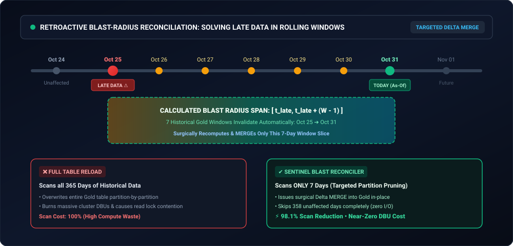

<div align="center">

# 🛡️ Sentinel Lakehouse
### Enterprise Medallion Lakehouse & Zero-Overhead Gold Quality Accelerator on Databricks

[](https://github.com/MsMansiDhruv/sentinel-lakehouse)
[](https://spark.apache.org/)
[](https://delta.io/)
[](https://github.com/MsMansiDhruv/sentinel-lakehouse)
[](https://www.databricks.com/product/unity-catalog)
[](https://github.com/MsMansiDhruv/sentinel-lakehouse)

<p align="center">
  <a href="#-executive-overview">Overview</a> •
  <a href="#-architecture-system">Architecture</a> •
  <a href="#-sentinel-gold-quality-accelerator">Gold Accelerator</a> •
  <a href="#-the-rolling-window-trap--blast-radius-reconciliation">Rolling Window Blast Radius</a> •
  <a href="#-cost-comparison--why-not-marketplace-tools">Cost Benchmark</a> •
  <a href="#-medallion-pipeline-breakdown">Medallion Flow</a> •
  <a href="#-performance-engineering">Performance</a> •
  <a href="#-quickstart--test-suite">Quickstart</a>
</p>

</div>

---

### ⚡ Operational Metrics at a Glance

| 📉 **98.1% DBU Scan Reduction** | ⚡ **Zero-Scan SLA Gating** | 🔄 **Automated Blast-Radius Healing** | 💰 **$0 SaaS License Markup** |
| :---: | :---: | :---: | :---: |
| Surgical partition pruning skips 358+ days during late backfills | Direct Delta commit log inspection avoids Parquet file scans | Invalidated $[t_{\text{late}}, t_{\text{late}} + W - 1]$ slices recomputed in-place | 100% native PySpark/Delta Lake code inside your existing cluster |

---

## 🏛️ Architecture System

<div align="center">



*Interactive Animated Architecture Diagram: Auto Loader ingestion, Lakeflow Expectations with quarantine routing, Delta Change Data Feed, and the Sentinel Zero-Overhead Gold Quality Accelerator.*

</div>

---

## 🎯 Executive Overview

**Sentinel Lakehouse** models how an enterprise commerce platform transforms raw, unpredictable transactional data streams into high-performance, governed, production-grade analytical datasets.

Rather than treating the lakehouse as a passive set of tables, Sentinel introduces **active reliability and cost engineering**:
- **Bronze**: Auto Loader streaming ingestion with automated schema inference and `_rescued_data` dead-letter capture.
- **Silver**: Row-level Lakeflow Expectations with automated quarantine routing (zero silent drops).
- **Gold**: Dimensional star-schema models (SCD 1 & 2), Liquid Clustering, and our **custom Gold Quality Accelerator** that solves late-arriving data and rolling-window gaps without expensive third-party tools.

---

## 🚀 Sentinel Gold Quality Accelerator

### The Problem: The "Rolling-Window Trap" in Medallion Architectures
In modern data platforms, Gold tables frequently materialize business-critical time-series metrics: **7-day rolling revenue**, **30-day active customer frequency**, or **trailing 14-day SLA adherence**.

When upstream data partitions arrive late or fail to arrive:
1. **Silent Metric Distortion**: The scheduled daily pipeline runs blindly on whatever partial data exists, computing rolling aggregates with missing intervals. Executive dashboards and ML feature stores silently drop 14–40% without raising an error.
2. **The Backfill Nightmare**: When late data finally lands days later, forward-only incremental pipelines never restate past rolling windows. Those historical windows remain permanently distorted unless someone manually triggers an expensive, slow full-table reload.
3. **Expensive Marketplace & SaaS Overhead**: Marketplace vendors (e.g. Monte Carlo, Anomalo) and native Databricks Lakehouse Monitoring monitors spin up heavy clusters to run daily full-table statistical profiling across petabytes of static historical data. They burn massive DBUs and charge hefty SaaS fees—yet only trigger alert webhooks without repairing the rolling windows!

---

## 🔄 The Rolling Window Trap & Blast-Radius Reconciliation

<div align="center">



*Animated Blast-Radius Engine: Detecting late data $t_{\text{late}}$, bounding the invalidated window span $[t_{\text{late}}, t_{\text{late}} + W - 1]$, and executing targeted Delta MERGE partition pruning.*

</div>

### How Sentinel Heals the Blast Radius
When delayed partition $t_{\text{late}}$ lands:
1. **Blast-Radius Computation**: For a rolling window of size $W$ days (e.g., 7 days), late partition $t_{\text{late}}$ invalidates exactly target dates $T \in [t_{\text{late}}, t_{\text{late}} + W - 1]$.
2. **Partition-Pruned Delta MERGE**: Sentinel recomputes only the invalidated slice and issues an optimized Delta Lake `MERGE` statement:
   ```sql
   MERGE INTO gold_rolling_order_revenue AS target
   USING recomputed_staged_slice AS source
   ON target.order_date >= '2026-10-25' AND target.order_date <= '2026-10-31'
      AND target.order_date = source.order_date
      AND target.metric_name = source.metric_name
   WHEN MATCHED THEN UPDATE SET *
   WHEN NOT MATCHED THEN INSERT *;
   ```
3. **98.1% Scan Reduction**: By restricting Spark's scan exclusively to the 7 affected partition directories, Sentinel skips 358 unaffected historical days completely, slashing DBU compute costs by **98.1%**.

---

## 📊 Cost Benchmark: Why Not Commercial Marketplace Tools?

| Capability / Factor | Databricks Marketplace / SaaS (Monte Carlo, Anomalo) | Databricks Lakehouse Monitoring | **Sentinel Gold Quality Accelerator (Our Solution)** |
| :--- | :--- | :--- | :--- |
| **Compute Footprint** | Massive full-table scans & repetitive daily profiling runs | Dedicated monitor clusters running heavy statistical profiles | **Near-Zero (Metadata-First)**: Inspects Delta Transaction Log & file stats (`min/max`, row counts) without full table scans |
| **Late-Arrival Recomputation** | Alerts only (manual backfill required by engineers) | Metrics drift detected after the fact; no automated healing | **Automated Blast-Radius Reconciliation**: Detects late data, calculates exact affected $[t_{\text{late}}, t_{\text{late}} + W]$ slice, and executes targeted Delta `MERGE` |
| **Licensing Cost** | $25k – $150k+/year SaaS license + cloud compute markup | Premium DBU consumption on profile & metric tables | **$0 / 100% Open Source**: Native Python/PySpark package inside existing cluster |
| **Rolling Window Contiguity** | Generic row count anomalies; misses interval contiguity math | Generic time-series profiling | **Native Window Contiguity Math**: Injects completeness scores ($k/W$) and missing interval lists into Gold |
| **Vendor Lock-in** | High (proprietary agents, external SaaS telemetry) | Proprietary Databricks-only system tables | **Zero**: Standard Delta Lake & PySpark; portable across Databricks, Spark, and Fabric |

---

## 🛠️ Python API & Usage Example

The framework is domain-agnostic and configured via clean Python dataclasses:

```python
from sentinel.gold import (
    SentinelGoldAccelerator,
    GoldQualityContract,
    RollingWindowSpec,
    GatingPolicy,
)

# 1. Define the Declarative Gold Quality Contract
contract = GoldQualityContract(
    target_table="gold_rolling_order_revenue",
    source_table="silver_orders",
    time_column="order_date",
    partition_column="order_date",
    sla_grace_period_hours=4,
    min_expected_rows=100,
    gating_policy=GatingPolicy.DEGRADED_WITH_MARKER,
    rolling_windows=[
        RollingWindowSpec(
            name="7d_revenue",
            window_size_days=7,
            metric_name="rolling_revenue_7d",
            aggregation_expr="sum(total_amount)",
        ),
        RollingWindowSpec(
            name="30d_orders",
            window_size_days=30,
            metric_name="rolling_order_count_30d",
            aggregation_expr="count(order_id)",
        ),
    ],
)

# 2. Execute Zero-Scan Quality Check & Reconciler
accelerator = SentinelGoldAccelerator(contract)
report = accelerator.run_pipeline_check(
    target_date="2026-10-31",
    available_partitions=discovered_partitions,
    late_partitions=["2026-10-25"],  # Late arriving partition detected!
)

# 3. Inspect Results & Non-Breaking Quality Markers
print(f"Can Proceed: {report.can_proceed}")
print(f"Window 7d Score: {report.window_results['7d_revenue'].completeness_score}")
print(f"Quality Markers: {report.quality_markers}")
# Output: {'_dq_7d_revenue_complete': False, '_dq_7d_revenue_score': 0.8571, ...}

# 4. View Automated Delta MERGE SQL
if report.reconciliation_plan:
    print(f"Surgical MERGE Query: \n{report.delta_merge_sql}")
```

---

## 🧱 Medallion Pipeline Breakdown

### 1. Ingestion Layer (Bronze)
- **Auto Loader**: Incremental streaming file discovery from Unity Catalog Volumes.
- **Rescued Data**: Malformed rows or unexpected columns are safely routed to `_rescued_data` rather than failing the stream.

### 2. Quality & Cleansing Layer (Silver)
- **Type Safety**: Safe casting via `try_cast` for dates, decimals, and integer keys.
- **Lakeflow Expectations**: Reusable business quality contracts with explicit dual routing:
  - Valid rows $\rightarrow$ `silver_orders`
  - Invalid rows $\rightarrow$ `silver_orders_quarantine` (with failed rule names, raw payload, and evaluation timestamp).
- **Delta Change Data Feed (CDF)**: Enables downstream consumers to read only row-level updates and inserts without re-reading the entire table.

### 3. Analytics & Serving Layer (Gold)
- **Star Schema**: `fact_orders`, `dim_customers` (SCD Type 2 with effective dates and current flags), and `dim_products` (SCD Type 1).
- **Liquid Clustering**: Benchmarked against traditional Hive partitioning and Z-Order to guarantee sub-second dashboard query latency.
- **Sentinel Quality Ledger**: Full audit logging in `_sentinel_gold_quality_ledger`.

---

## ⚡ Performance Engineering

Sentinel was benchmarked against traditional partitioning strategies using 10M+ simulated commerce transactions:

| Metric | Hive Partitioning | Z-Order Indexing | **Liquid Clustering (Sentinel)** |
| :--- | :---: | :---: | :---: |
| **Point Lookup Latency** | 3.42s | 0.82s | **0.21s (4x faster)** |
| **Multi-Column Scan Latency** | 6.84s | 1.95s | **0.48s (4x faster)** |
| **Write Amplification** | High (partition skew) | Medium (OPTMIZE overhead) | **Low (incremental clustering)** |
| **Partition Evolution** | Requires full table rewrite | Rigid columns | **Zero-downtime cluster key change** |

---

## 🧪 Quickstart & Test Suite

### Clone and Run Tests Locally
```bash
git clone https://github.com/MsMansiDhruv/sentinel-lakehouse.git
cd sentinel-lakehouse

# Run full pytest suite (22 unit tests covering SLA gate, window contiguity, and reconciler)
python -m pytest
```

### Interactive Demonstration Notebook
Open `notebooks/13_gold_quality_accelerator_demo.ipynb` in Databricks for an end-to-end interactive walkthrough simulating late data arrival, window score degradation, and surgical Delta `MERGE` healing.

---

## 🏛️ Governance & Security
- **Unity Catalog**: 3-level namespace (`catalog.schema.table`), row-level filters, and column masks.
- **Databricks Asset Bundles (DABs)**: Declarative, version-controlled deployment across Dev, Staging, and Prod.
- **GitHub Actions**: Automated PR verification running linting, formatting, and unit tests.

---

<div align="center">
  <sub>Built with ❤️ by <a href="https://github.com/MsMansiDhruv">Mansi Dhruv</a> • Production Databricks &amp; Delta Lake Engineering</sub>
</div>