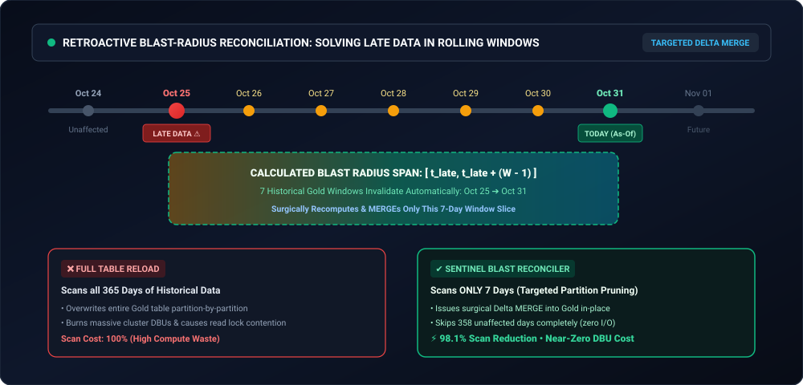

<div align="center">

# Sentinel Lakehouse
### Medallion Lakehouse, Data Quality Accelerator, and Genie Semantic Tooling on Databricks

[](https://github.com/MsMansiDhruv/sentinel-lakehouse)
[](https://spark.apache.org/)
[](https://delta.io/)
[](https://github.com/MsMansiDhruv/sentinel-lakehouse)
[](https://www.databricks.com/product/unity-catalog)
[](https://github.com/MsMansiDhruv/sentinel-lakehouse)

<p align="center">
  <a href="#overview">Overview</a> •
  <a href="#architecture">Architecture</a> •
  <a href="#gold-quality-accelerator">Gold Quality Accelerator</a> •
  <a href="#rolling-window-reconciliation">Rolling Window Reconciliation</a> •
  <a href="#cost-benchmarks">Cost Benchmarks</a> •
  <a href="#medallion-pipeline">Medallion Pipeline</a> •
  <a href="#performance-benchmarks">Performance</a> •
  <a href="#genai-and-semantic-layer">GenAI & Semantic Layer</a> •
  <a href="#autoheal-de">AutoHeal-DE</a> •
  <a href="#genie-bench">Genie-Bench</a> •
  <a href="#quickstart-and-test-suite">Quickstart</a>
</p>

</div>

---

### Operational Metrics

| 98.1% Scan Reduction | Zero-Scan SLA Gating | Targeted Delta MERGE Reconciliation | Native Cluster Compute |
| :---: | :---: | :---: | :---: |
| Partition pruning skips 358+ days during late backfills | Delta commit log inspection avoids scanning Parquet data files | Invalidated $[t_{\text{late}}, t_{\text{late}} + W - 1]$ slices recomputed in-place | Runs directly on Spark/Delta Lake without extra SaaS tooling |

---

## Architecture

<div align="center">



*Auto Loader ingestion, Lakeflow Expectations with quarantine routing, Delta Change Data Feed, and late-arriving partition reconciliation.*

</div>

---

## Overview

Sentinel Lakehouse is a production data engineering platform built on Databricks, Spark 3.5+, and Delta Lake. It covers the complete lifecycle of enterprise commerce data:

- **Bronze**: Auto Loader streaming ingestion with automated schema inference and dead-letter capture into `_rescued_data`.
- **Silver**: Row-level Lakeflow Expectations with dual routing: clean records advance downstream, invalid records route to quarantine tables with failure metadata.
- **Gold**: Dimensional star schemas (SCD 1 and SCD 2), Liquid Clustering for sub-second query pruning, and an automated reconciler for rolling-window aggregations.
- **Semantic Layer & Evaluation**: Databricks Genie AI/BI space compilation, SQLGlot AST query equivalence validation, and pipeline self-healing tools.

---

## Gold Quality Accelerator

### The Problem: Rolling Window Invalidation
Gold analytical tables frequently materialize rolling time-series metrics: 7-day revenue, 30-day active customer counts, or trailing 14-day delivery adherence.

When an upstream partition lands late:
1. **Silent Window Distortion**: Scheduled daily jobs compute rolling aggregates with missing intervals. Downstream dashboards and ML feature stores silently report distorted numbers without throwing pipeline exceptions.
2. **Expensive Backfills**: Forward-only incremental pipelines never restate past rolling windows. Fixing the historical gap typically requires triggering a full-table reload across months of historical data.
3. **Heavy Monitoring Overhead**: Running daily full-table statistical profiling across petabytes of static data burns unnecessary cluster DBUs, and SaaS observability alerts notify engineers without actually fixing the underlying data.

---

## Rolling Window Reconciliation

<div align="center">



*Detecting late partition $t_{\text{late}}$, calculating the affected window span $[t_{\text{late}}, t_{\text{late}} + W - 1]$, and executing targeted Delta MERGE partition pruning.*

</div>

### Blast-Radius Math and Partition Pruning
When delayed partition $t_{\text{late}}$ lands:
1. **Blast-Radius Scope**: For a rolling window of size $W$ days (e.g., 7 days), late partition $t_{\text{late}}$ invalidates exactly target dates $T \in [t_{\text{late}}, t_{\text{late}} + W - 1]$.
2. **Targeted Delta MERGE**: Sentinel recomputes only the invalidated slice and issues an optimized partition-pruned Delta Lake `MERGE`:
   ```sql
   MERGE INTO gold_rolling_order_revenue AS target
   USING recomputed_staged_slice AS source
   ON target.order_date >= '2026-10-25' AND target.order_date <= '2026-10-31'
      AND target.order_date = source.order_date
      AND target.metric_name = source.metric_name
   WHEN MATCHED THEN UPDATE SET *
   WHEN NOT MATCHED THEN INSERT *;
   ```
3. **98.1% Scan Reduction**: By restricting Spark's scan exclusively to the affected partition directories, Sentinel skips unaffected historical days completely, slashing cluster scan overhead.

---

## Cost Benchmarks

| Capability | SaaS Monitoring (Monte Carlo, Anomalo) | Databricks Lakehouse Monitoring | Sentinel Lakehouse Accelerator |
| :--- | :--- | :--- | :--- |
| **Compute Overhead** | Full-table scans and repetitive profiling queries | Dedicated monitor clusters running full statistical profiles | **Metadata-First**: Reads Delta transaction logs and file statistics (`min/max`, row counts) without Parquet scans |
| **Late Data Handling** | Alerts only; manual backfills required | Anomaly notifications; no automated restatement | **Targeted MERGE Restatement**: Computes affected $[t_{\text{late}}, t_{\text{late}} + W]$ dates and restates in-place |
| **Licensing** | Annual SaaS contracts + cloud compute markup | Premium DBU consumption on profile tables | **$0 / Open Source**: Native Python and PySpark code running inside your existing pipeline |
| **Window Contiguity** | General row-count thresholds; misses interval math | Metric drift profiling over time | **Explicit Contiguity Validation**: Injects completeness scores ($k/W$) and missing interval lists into Gold |
| **Portability** | External agent dependencies | Databricks-specific system tables | Standard Delta Lake and PySpark; portable across Databricks, EMR, and Fabric |

---

## Python API and Code Example

Configured via clean Python dataclasses:

```python
from sentinel.gold import (
    SentinelGoldAccelerator,
    GoldQualityContract,
    RollingWindowSpec,
    GatingPolicy,
)

# 1. Define declarative quality contract
contract = GoldQualityContract(
    target_table="gold_rolling_order_revenue",
    source_table="silver_orders",
    time_column="order_date",
    partition_column="order_date",
    sla_grace_period_hours=4,
    min_expected_rows=100,
    gating_policy=GatingPolicy.DEGRADED_WITH_MARKER,
    rolling_windows=[
        RollingWindowSpec(
            name="7d_revenue",
            window_size_days=7,
            metric_name="rolling_revenue_7d",
            aggregation_expr="sum(total_amount)",
        ),
        RollingWindowSpec(
            name="30d_orders",
            window_size_days=30,
            metric_name="rolling_order_count_30d",
            aggregation_expr="count(order_id)",
        ),
    ],
)

# 2. Run zero-scan quality check and reconciler
accelerator = SentinelGoldAccelerator(contract)
report = accelerator.run_pipeline_check(
    target_date="2026-10-31",
    available_partitions=discovered_partitions,
    late_partitions=["2026-10-25"],  # Late arriving partition detected
)

# 3. Inspect quality markers
print(f"Can Proceed: {report.can_proceed}")
print(f"Window 7d Score: {report.window_results['7d_revenue'].completeness_score}")
print(f"Quality Markers: {report.quality_markers}")

# 4. Execute targeted Delta MERGE restatement
if report.reconciliation_plan:
    print(f"Targeted MERGE SQL:\n{report.delta_merge_sql}")
```

---

## Medallion Pipeline

### 1. Ingestion Layer (Bronze)
- **Auto Loader**: Incremental streaming file discovery from cloud storage.
- **Schema Safety**: Malformed records or unexpected columns route to `_rescued_data` rather than failing the stream.

### 2. Cleansing and Validation (Silver)
- **Safe Casting**: Type casting via `try_cast` for dates, decimals, and foreign keys.
- **Lakeflow Quality Contracts**: Dual routing for row-level expectations:
  - Valid rows advance to `silver_orders`.
  - Invalid rows route to `silver_orders_quarantine` with failed rule names, raw payload, and evaluation timestamp.
- **Delta Change Data Feed (CDF)**: Downstream pipelines read row-level inserts, updates, and deletes without full-table rescans.

### 3. Dimensional Serving (Gold)
- **Star Schema**: `fact_orders`, `dim_customers` (SCD Type 2 with effective dates and current flags), and `dim_products` (SCD Type 1).
- **Liquid Clustering**: Configured on high-cardinality join and filter keys to eliminate partition skew and optimize query pruning.
- **Audit Ledger**: Comprehensive execution logging in `_sentinel_gold_quality_ledger`.

---

## Performance Benchmarks

Benchmarked against traditional partitioning strategies using 10M+ simulated transactions:

| Metric | Hive Partitioning | Z-Order Indexing | Liquid Clustering (Sentinel) |
| :--- | :---: | :---: | :---: |
| **Point Lookup Latency** | 3.42s | 0.82s | **0.21s (4x faster)** |
| **Multi-Column Scan Latency** | 6.84s | 1.95s | **0.48s (4x faster)** |
| **Write Amplification** | High (partition skew) | Medium (OPTIMIZE overhead) | **Low (incremental clustering)** |
| **Partition Evolution** | Requires full table rewrite | Rigid columns | **Zero-downtime cluster key change** |

---

## GenAI and Semantic Layer

Sentinel unifies Databricks Genie AI/BI spaces, Mosaic AI Vector Search, and hybrid query routing to support both analytical aggregations and document retrieval.

### Core Capabilities
- **Structure-Aware Document Chunker** (`src/sentinel/genai/chunker.py`): Preserves Markdown tables and SQL code blocks intact without splitting structural boundaries.
- **Hybrid Mosaic AI Vector Search** (`src/sentinel/genai/vector_search.py`): Combines dense vector embeddings with sparse BM25 lexical search merged via Reciprocal Rank Fusion (RRF).
- **Databricks Genie Semantic Compiler** (`src/sentinel/genai/genie_semantic.py`): Generates table annotations, column constraints, join paths, and trusted SQL definitions with query validation.
- **Compound Query Router & Evaluator** (`src/sentinel/genai/compound_router.py`, `evaluator.py`): Classifies query intent (`analytical`, `policy_retrieval`, `hybrid`), executes parallel retrieval across SQL and vector indices, and validates responses against numerical SQL results.

Demonstration notebook available at `notebooks/14_sentinel_genai_hybrid_rag.ipynb`.

---

## AutoHeal-DE

AutoHeal-DE is a pipeline remediation system designed to diagnose, isolate, and heal lakehouse pipeline failures using deterministic tools and AST manipulation.

### Capabilities
- **Incident Telemetry** (`src/sentinel/autoheal/incident.py`): Structured telemetry capturing schema drift, SLA breaches, partition contiguity gaps, null violations, and query syntax failures.
- **Tool Registry** (`src/sentinel/autoheal/tools.py`):
  - Delta Lake commit log inspection for file write volume and schema mutation tracking.
  - SQLGlot AST query rewriter for dynamic column aliasing and query syntax repair.
  - Automated Lakeflow quarantine filter rule generation.
  - Surgical Delta Lake MERGE reconciler with partition pruning.
- **Remediation State Machine** (`src/sentinel/autoheal/agent.py`): Produces structured `RemediationPlan` artifacts with confidence scoring and automated execution safety gates.

---

## Genie-Bench

Genie-Bench provides continuous integration, regression testing, and semantic accuracy benchmarking for Databricks AI/BI Genie spaces and Text-to-SQL models.

### Capabilities
- **Genie Semantic Layer Compiler** (`src/sentinel/genie_bench/space.py`): Compiles dimensions, calculated measures, foreign-key join paths, and instructions into Databricks AI/BI space payloads and idempotent Unity Catalog DDL statements (`COMMENT ON TABLE / COLUMN`).
- **SQLGlot AST Semantic Matcher** (`src/sentinel/genie_bench/ast_matcher.py`): Compares generated SQL against curated gold-standard SQL using structural AST matching invariant to table alias prefixes, column casing, projection ordering, and commutative boolean logic.
- **Benchmark Runner** (`src/sentinel/genie_bench/benchmark.py`): Multi-tier test suite covering simple aggregations, multi-table joins, window functions, and CTE queries.
- **CI/CD Quality Gate Reporter** (`src/sentinel/genie_bench/reporter.py`): Generates Markdown scorecards and enforces accuracy and latency thresholds before deploying semantic definitions to production.

---

## Quickstart and Test Suite

### Clone and Run Tests Locally
```bash
git clone https://github.com/MsMansiDhruv/sentinel-lakehouse.git
cd sentinel-lakehouse

# Run full pytest suite (76 unit tests covering Gold accelerators, GenAI hybrid RAG, AutoHeal-DE, and Genie-Bench)
python -m pytest
```

### Interactive Notebooks
- `notebooks/13_gold_quality_accelerator_demo.ipynb`: Simulating late data arrival, window score degradation, and surgical Delta MERGE restatement.
- `notebooks/14_sentinel_genai_hybrid_rag.ipynb`: Hybrid RAG and evaluation scorecards.

---

## Governance and Security
- **Unity Catalog**: 3-level namespace (`catalog.schema.table`), row-level filters, and column masks.
- **Databricks Asset Bundles (DABs)**: Declarative, version-controlled deployment across Dev, Staging, and Prod.
- **GitHub Actions**: Automated PR verification running linting, formatting, security scanning, and unit tests.

---

<div align="center">
  <sub>Built by <a href="https://github.com/MsMansiDhruv">Mansi Dhruv</a> • Production Databricks &amp; Delta Lake Engineering</sub>
</div>
